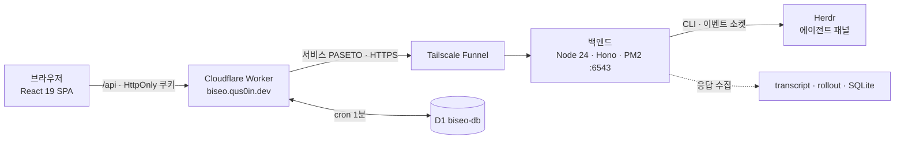

# Biseo

> 나의 소프트웨어 공장 비서 — Herdr 위에서 도는 여러 AI 에이전트 패널을 브라우저에서 보고, 지시하고, 결과를 받는다.

운영: https://biseo.qus0in.dev (v0.3.2). 개발 브랜치 `dev`는 0.3.3 작업 중.

## 전체 흐름

## 1. 브라우저 (`web/`)

- 채팅이 항상 메인 화면. `/chat/:paneId`로 들어와도 같은 화면에서 해당 pane이 선택된다.
- 좌측 pane drawer에 pane 목록. 별로 최대 2개까지 고정(pinned), 고정 목록과 사용량 표시 여부는 localStorage에 저장.
- 상단 헤더에 **사용량 탭**과 **알림 탭**. 사용량은 모달로 전체 provider 사용량·한도·reset 표시. 알림은 북마크한 pane의 턴 완료·차단 등 주요 결과를 SSE로 수신해 목록으로 표시(읽음 표시).
- 응답은 sanitize한 마크다운으로 보여 주고, 원본과 전환 가능. Mermaid 렌더링 지원.
- 타임라인은 pane·seq 커서로 페이지네이션.
- 라이트 테마만 사용 (`theme-color #F4F7F5`).

레이어: `ui → app → domain`, infra는 포트 구현. `uiStore`(zustand)로 선택 pane·pinned 유지.

## 2. Cloudflare Worker (`worker/`)

| 경로 | 역할 |
|---|---|
| `POST /api/login`, `/api/logout`, `GET /api/session` | 비밀번호 로그인, PASETO v4.public HttpOnly 쿠키, KV `LOGIN_ATTEMPTS`로 시도 제한 |
| `GET /api/config`, `/api/workspaces/:wsId/panes` | workspace 설정과 pane 목록 중계 |
| `POST /api/timeline/messages`, `DELETE /api/turns/:requestId` | 턴 전송과 예약 취소 중계, D1 기록 |
| `GET /api/timeline/messages(/:requestId)`, `/api/timeline/stream` | D1에 저장된 최근 결과 조회, SSE 스트림 |
| `POST /api/panes/:paneId/interrupt` | Esc 등 허용된 키로 차단 해제 |
| `GET /api/usage` | provider 사용량(D1 캐시) |
| `GET /api/health` | 백엔드 health 중계 |

- 상태를 바꾸는 요청은 Origin/CSRF 검사와 workspace allowlist를 통과해야 한다.
- 백엔드를 호출할 때는 짧게 유효한 서비스 PASETO를 붙인다.
- **scheduled (cron `* * * * *`)**: 늦게 끝난 턴 회수(`scheduled-turns`), 사용량 snapshot(`scheduled-usage`), workspace 동기화(`scheduled-workspace`). 실패하면 backoff.

## 3. D1 `biseo-db` (`worker/migrations/`)

| 마이그레이션 | 테이블 | 용도 |
|---|---|---|
| `0001_timeline.sql` | `timeline_turns` | requestId·소유자·workspace·pane·prompt·응답·상태 |
| `0002_usage.sql` | `usage_snapshots` | provider별 사용량·한도·reset 시각 |
| `0003_sync.sql` | `sync_state` | cron 동기화 커서·lease |

- 모든 조회에 소유자·workspace 범위를 적용하고, D1이 실패하면 fail-closed로 처리한다.
- 비밀키·토큰·쿠키·터미널 전체 내용은 저장하지 않는다.

## 4. 백엔드 (`src/`, PM2 `biseo`)

라우트 (`src/ui/app-routes.ts`):

| 라우트 | 역할 |
|---|---|
| `POST /herdr/turns`, `GET`/`DELETE /herdr/turns/:requestId` | 턴 생성·조회·예약 취소 |
| `GET /herdr/events` | 패널·턴 상태 SSE (`Last-Event-ID`로 이어 받기) |
| `GET /herdr/workspaces/:wsId/panes`, `/herdr/config` | pane 목록, 동적 workspace 설정 |
| `POST /herdr/panes/:paneId/interrupt` | 허용된 키만 전송 (OpenCode `ctrl+c`는 거부) |
| `GET /herdr/usage` | 로컬 사용량 수집 결과 |

- 턴 큐: pane별 FIFO, 수락 게이트, 타임아웃·늦은 응답 수집.
- 사용량: `usage-collector`가 codex rollout에서 rate limit을 읽어 primary/secondary window로 노출. 실패 시 `unknown`/`windows: []`.
- 응답 수집: claude/agy/codex/opencode별 transcript 파서.

## 5. Herdr와 응답 수집

| 에이전트 | 응답 출처 |
|---|---|
| claude | Claude transcript JSONL |
| agy (Antigravity) | Antigravity transcript JSONL |
| codex | Codex rollout JSONL, SessionStart hook이 남긴 pane→session 상태 파일 |
| opencode | OpenCode SQLite |

## 레이어 규칙

의존 방향은 `ui → app → domain ← infra`이고, 조립은 진입점(`worker/index.ts`, `src/index.ts`)에서만 한다. `shared/`는 claims·timeline 포트와 PASETO 구현을 Worker와 백엔드에 함께 제공한다. 모듈은 128줄·1024자 이하로 유지한다.