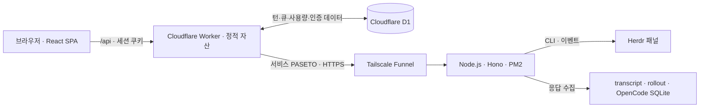

# Biseo

Herdr의 여러 AI 에이전트 패널을 브라우저에서 보고, 지시하고, 결과를 받는 소프트웨어 공장 비서다.

- 운영: https://biseo.qus0in.dev
- 정식 릴리스: [v0.6.0](https://github.com/qus0in-factory/biseo/releases/tag/v0.6.0). 이후 main 수정과 운영 배포는 새 태그·릴리스 발행과 구분한다.
- [Wiki](https://github.com/qus0in-factory/biseo/wiki) · [현행 운영](docs/ops/current-operations.md) · [개발·승격](docs/development.md)

## 할 수 있는 일

- 워크스페이스와 패널을 선택하고, 패널 생성·이름 변경·종료 및 목록 순서를 관리한다.
- 메시지를 보내고, 예약 취소·허용된 인터럽트·타임라인·SSE와 최근 결과 조회로 작업 상태를 확인한다.
- 응답을 마크다운 또는 원본으로 읽고 Mermaid 다이어그램을 표시한다.
- 제공자별 사용량·한도·리셋 시각을 확인한다. 모델 관측과 사용량 수집은 별도 경로다.
- 비밀번호 또는 허용된 신뢰 IP의 6자리 PIN으로 로그인한다. 로그인 폼은 헤더 아래 남은 화면 영역에 배치한다.

화면 상태줄 기반 모델 관측은 OpenCode(`recent-unwrapped`)와 AGY(`visible`)를 지원한다. 패널 별칭으로 모델을 추측하지 않는다. effort 감지·표시는 [#214 제안](https://github.com/qus0in-factory/biseo/issues/214)이며 아직 구현하지 않았다.

## 구조



| 경로 | 책임 |
| --- | --- |
| `web/` | React 화면, 워크스페이스·패널 선택, 로그인, 메시지·타임라인 |
| `worker/` | 공개 API, 인증·Origin 검사, 백엔드 중계, D1 큐·cron |
| `src/` | Herdr 제어, 모델 관측, 사용량·응답 수집, 로컬 API |
| `shared/` | Worker·백엔드 공통 계약과 토큰 처리 |
| `config/` | 공유 기본 설정과 환경별 설정 경계 |
| `worker/migrations/` | D1 스키마 변경 이력 |

레이어는 `ui → app → domain ← infra`다. 모델 관측은 `src/app/pane-model-observe.ts`, 캐시는 `pane-model-cache.ts`에서 처리한다. API 경로는 `worker/ui/routes-registry.ts`와 `src/ui/app-routes.ts`를 기준으로 확인한다.

## 실행과 검증

Node.js 24 이상과 pnpm 11.24.0이 필요하다. Herdr 연결, 서비스 검증키, Worker 바인딩·시크릿 등 환경 준비는 [현행 운영 문서](docs/ops/current-operations.md)를 따른다. 설치·빌드만으로 운영 환경이 구성되는 것은 아니다.

```sh
pnpm install --frozen-lockfile
pnpm test
pnpm typecheck
pnpm build
```

- `pnpm start`: 빌드한 로컬 백엔드 실행.
- `pnpm dev`: 클라이언트 빌드 후 로컬 Worker 실행.
- 기존 전체 검사는 984개다. 검증 결과와 테스트 탐색 규칙은 [개발 문서](docs/development.md)를 참고한다.

## 변경·운영 원칙

- 작업 브랜치를 dev에 통합하고 검증한 뒤 dev→main PR로 승격한다. main 직접 push·보호 우회는 하지 않는다.
- 백엔드와 Worker는 별도로 배포·검증한다. 재시작 전 현재 실행 경로와 진행 중 작업을 확인한다.
- 공유 가능한 기본 설정은 Git으로 관리하고, 비밀키·토큰·운영 오버라이드는 보호된 저장소와 환경에서 관리한다. 로그나 문서에 값을 남기지 않는다.
- 운영 설정·사용자 미커밋 변경을 배포 편의상 덮어쓰지 않는다. 태그·정식 릴리스 발행은 별도 승인 사항이다.

관련 기록: [AGY 모델 관측 부검](docs/ops/postmortem-213-agy-model.md) · [이슈](https://github.com/qus0in-factory/biseo/issues).
